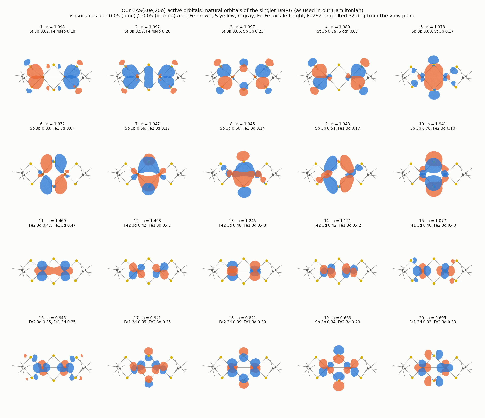
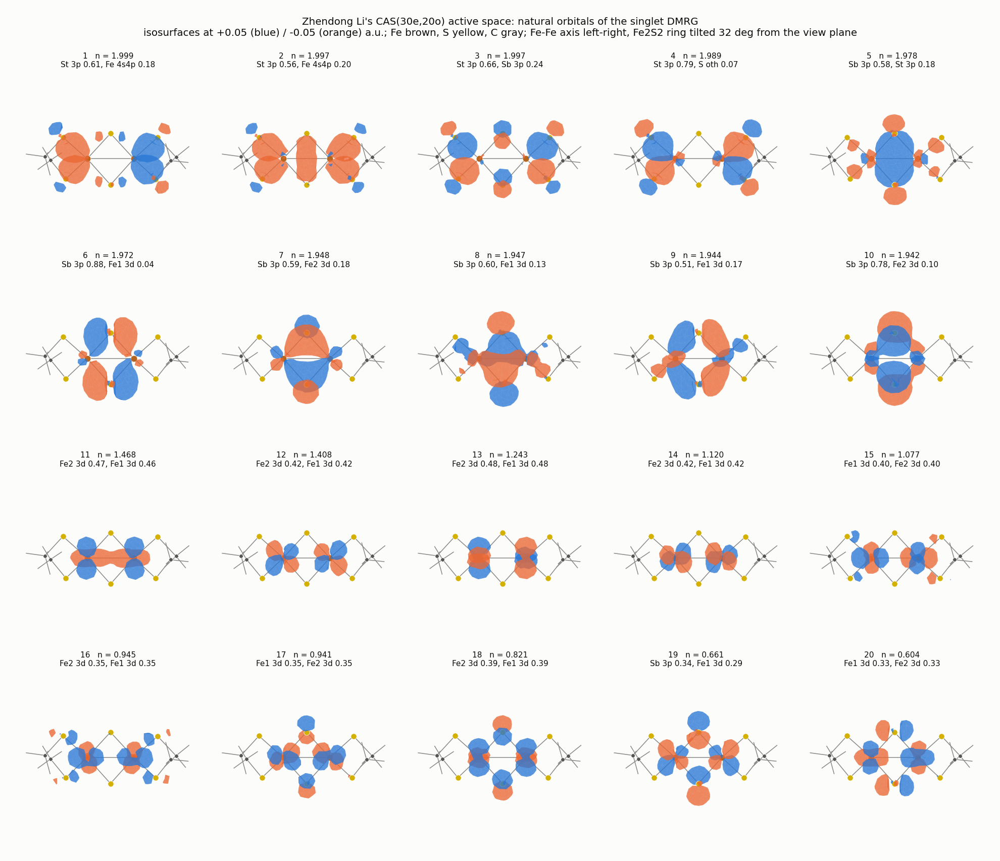
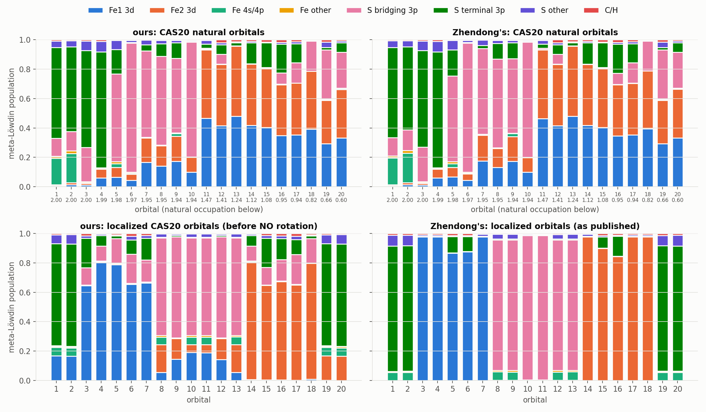
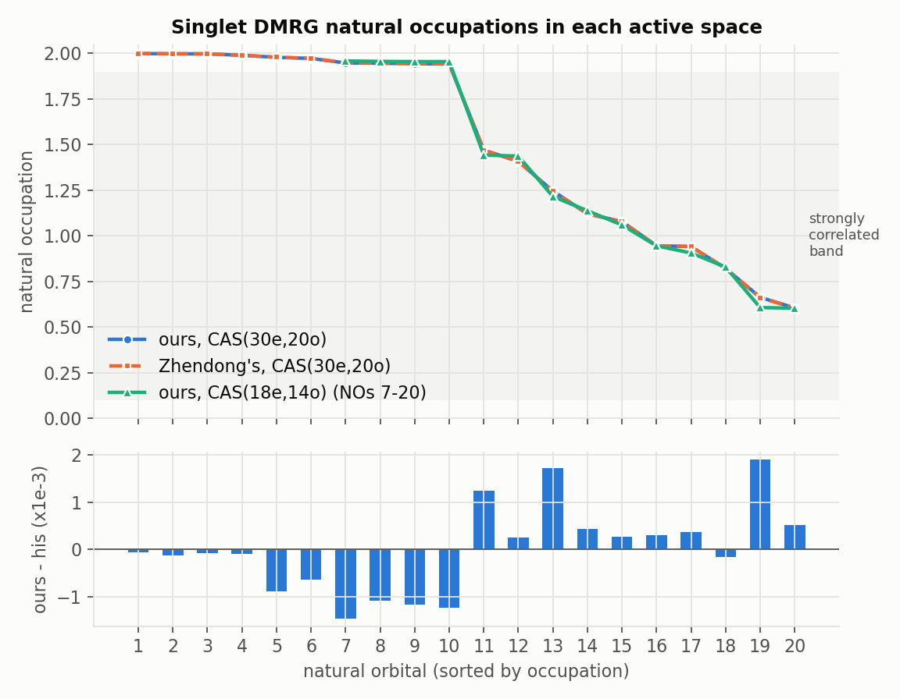
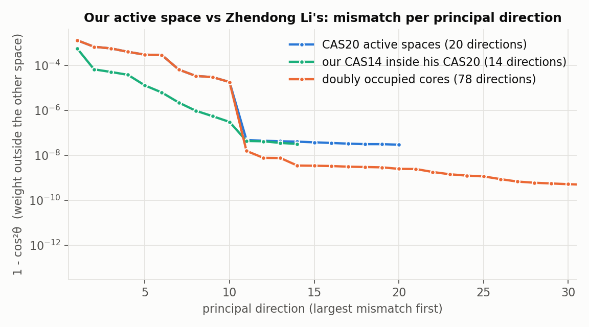
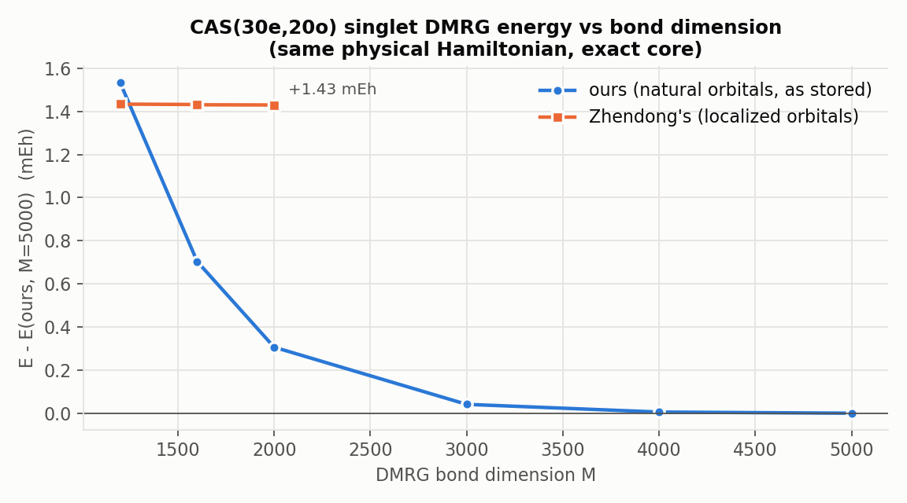

# CAS(30e,20o) active space for [Fe2S2(SCH3)4]2-: orbital checks and comparison with the reference active space

Analysis of 2026-10-19. The reference active space is the one published in
[zhendongli2008/Active-space-model-for-Iron-Sulfur-Clusters](https://github.com/zhendongli2008/Active-space-model-for-Iron-Sulfur-Clusters)
(orbital coefficients `Fe2S2_and_Fe4S4/Fe2S2/mole.h5`, added in commit 734dbdd48c, 2026-10-10: 78 doubly occupied and 20 active
orbitals of its CASCI(30e,20o)). It uses the same geometry, basis (TZP-DKH, 662 AOs) and spin-free X2C-1e Hamiltonian as this
reconstruction. "This work" below means the final orbitals of steps 06-09 of this repository.

## Construction (summary of steps 02-09)
- Geometry: Sharma et al. 2014 (SI Table 1, oxidized dimer); basis TZP-DKH (662 AOs); spin-free X2C-1e; physical Hamiltonian (no XC).
- Orbitals: unrestricted natural orbitals of an all-electron high-spin (S = 5) UKS/BP86 calculation define core, doubly occupied,
  singly occupied and virtual sets (occupation cuts 1.5 / 0.5). The occupied sets are Pipek-Mezey localized, and a CAS(30e,20o) of
  Fe 3d (10), bridging-S 3p (6) and terminal-S 3p (4) character is selected. The active orbitals are then rotated to the natural
  orbitals of the singlet CAS(30e,20o) DMRG one-particle density matrix. 44 core orbitals (Fe/S [Ne], C 1s) are frozen.
- CAS(18e,14o) is the subset obtained by keeping the six most strongly occupied active natural orbitals doubly occupied.

## The active orbitals

The natural orbitals of the reference active space
([zhendongli2008/Active-space-model-for-Iron-Sulfur-Clusters](https://github.com/zhendongli2008/Active-space-model-for-Iron-Sulfur-Clusters)),
computed and drawn the same way, match ours one to one (overlap >= 0.979 per orbital; the overall sign of an orbital is arbitrary,
so lobe colors can be swapped, e.g. orbitals 2, 5 and 7; orbitals 7 and 8 are nearly degenerate, n = 1.947 / 1.945):

Each orbital's composition (meta-Lowdin populations), for our orbitals and for the reference active space (same geometry, basis
and Hamiltonian):

| active space | Fe1 3d | Fe2 3d | bridging S 3p | terminal S 3p |
|---|---:|---:|---:|---:|
| this work | 4.678 | 4.678 | 5.526 | 3.877 |
| reference | 4.678 | 4.678 | 5.525 | 3.876 |

## Correlation content
Natural occupations of the singlet CAS(30e,20o) DMRG ground state; both spaces have the same 10 strongly correlated orbitals
(occupations 1.47 to 0.60), agreeing to within 0.002:

## Agreement with the reference active space
All 20 principal-angle cosines between the two 20-orbital spaces are at least 0.99935 (mean cos^2 = 0.99982); the 78-orbital
doubly occupied cores agree equally well, and the CAS(18e,14o) lies inside the reference CAS(30e,20o) (cosines >= 0.9997).

Recomputing the reference core energy and active one-electron integrals from the reference orbitals with our Hamiltonian reproduces
the published values (-4976.265323968 vs -4976.26532397 Eh; 6e-10), so both active spaces are defined on the identical physical
Hamiltonian. CASCI(30e,20o) energies (78 doubly occupied orbitals, DMRG converged to microhartree):

| active space | E (Eh) |
|---|---:|
| this work | -5092.8723626 |
| reference | -5092.8709326 |

The 1.43 mEh lower CASCI energy indicates a slightly better core/active partition for this active space. Neither orbital set is
CASSCF-optimized. The reference localized orbitals are more local than ours, which lowers the DMRG bond dimension needed (convergence
at M ~ 1200 versus 4000-5000 for our natural orbitals) but does not change the active space or its energy.
